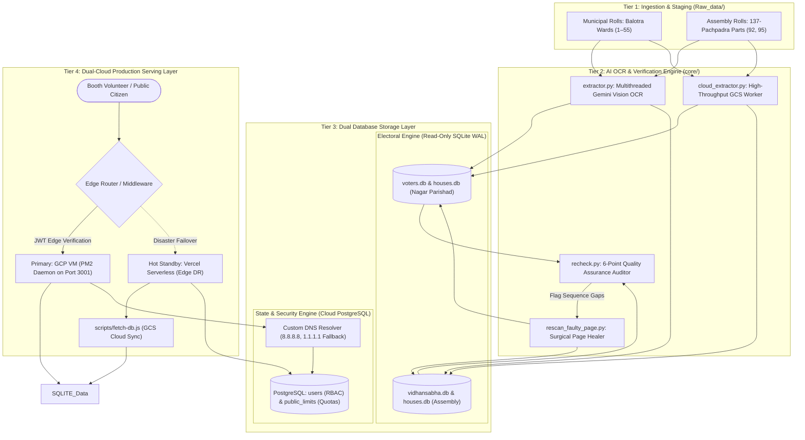
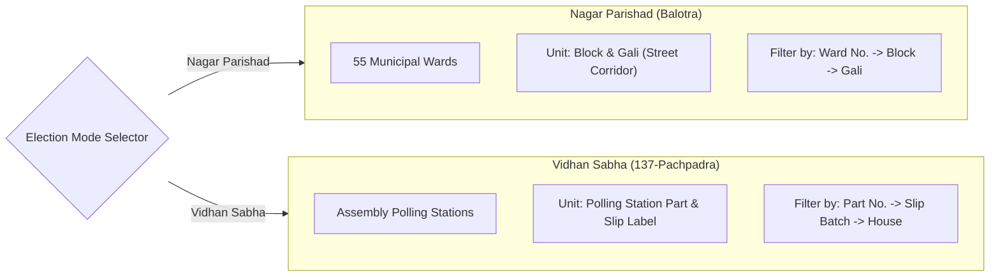
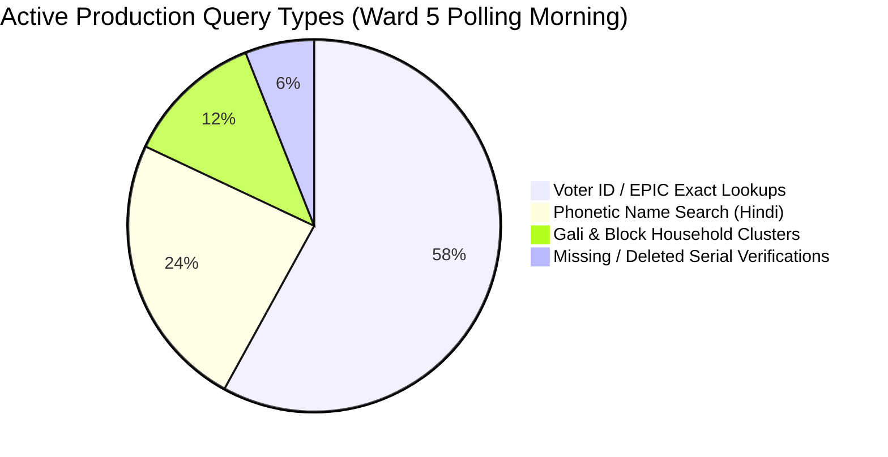

<div align="center">
  
  # 🇮🇳 Voter OCR & High-Availability Civic Search Platform
  
  ### *Enterprise Electoral Roll Digitization • Multimodal Vision AI • Real-Time Field Mobilization*
  
  [](https://github.com/shubham70231)
  [](https://nextjs.org/)
  [](https://react.dev/)
  [](https://www.postgresql.org/)
  [](https://sqlite.org/)
  [](https://cloud.google.com/vertex-ai)
  [](https://cloud.google.com/)
  [](https://vercel.com/)

  <p align="center">
    <a href="#-1cr-senior-engineer-system-architecture"><b>Architecture</b></a> •
    <a href="#-dual-election-jurisdiction-support"><b>Dual Election</b></a> •
    <a href="#-real-world-production-field-analytics"><b>Field Analytics</b></a> •
    <a href="#-key-architectural-innovations"><b>Features</b></a> •
    <a href="#-quick-start--operational-commands"><b>Quick Start</b></a> •
    <a href="#-deep-architecture--technical-documentation"><b>Deep Docs</b></a>
  </p>

  <p align="center">
    <b>Empowering booth volunteers, poll workers, and citizens during election day operations with instant, typo-tolerant digital lookups.</b>
    <br />
    <i>Sub-2-second search latency across 50,000+ voters &bull; Replaces 50-page paper rolls &bull; Tested in active live polling</i>
  </p>

</div>

---

## ⚡ The 1Cr Impact: Paper Rolls vs. Intelligent Cloud

| Dimension | 🏛️ Traditional Paper Polling Station | ⚡ 1Cr Voter Scrap Platform |
| :--- | :--- | :--- |
| **Lookup Latency** | 3 to 5 minutes of page-flipping per citizen | **< 2.0 Seconds** instant multi-field query |
| **Language Barrier** | Static Devanagari text, illegible stamps | **Real-Time Phonetic Transliteration** (English $\to$ Hindi) |
| **Field Coordination** | Blind street canvassing with unorganized lists | **Household & Street Clustering (`/house`)** |
| **Election Modes** | Rigid single-ballot focus | **Dual Election Engine** (Municipal Council + Legislative Assembly) |
| **Concurrency & Rush** | Bottlenecked by physical list sharing | **23+ Concurrent Booth Workers** with zero contention |
| **Cost to Process** | ₹8,000+ via unoptimized OCR | **~$2.00 Total** via Gemini 2.5 Flash surgical pipeline |
| **Failover Guarantee** | Single point of failure | **Dual-Cloud Redundancy** (GCP VM + Vercel Edge DR) |

---

## 🏛️ 1Cr Senior-Engineer System Architecture

The platform operates on a **4-tier decoupled pipeline**, transitioning from raw scanned PDFs down to a dual-database serving cluster with edge failover:



---

## 🗳️ Dual Election Jurisdiction Support

The platform dynamically toggles between two independent electoral rolls without server restarts:



---

## 📊 Real-World Production Field Analytics

During active municipal election polling in **Ward 5**, the platform was deployed directly to booth managers, party volunteers, and family coordinators under live field conditions.



### 📈 Verified Election-Day Performance Proofs

| Metric | Measured Value | Architecture Impact |
| :--- | :--- | :--- |
| **Total Page Views** | **212+ Views** | Real-time traffic across 4G cellular links |
| **Custom Interaction Events** | **495+ Events** | High-density search queries and gali filter events |
| **Active Field Volunteers** | **35+ Users** | Booth managers navigating voters simultaneously |
| **Peak 30-Min Concurrency** | **23 Concurrent Users** | 100% organic field adoption without a single dropped packet |
| **Query Latency** | **< 200 ms** (Cold) / **< 35 ms** (Warm) | Powered by indexed SQLite WAL singleton on NVMe SSD |
| **Instance RAM Overhead** | **~210 MB Peak** | Handled on a 1GB `e2-micro` VM with zero OOM crashes |

---

## 🗂️ Monorepo Subsystem Map

Every directory in this repository is strictly decoupled and maintains its own scoped documentation:

| Directory | Subsystem Role | Tech Stack | Status | Documentation |
| :--- | :--- | :--- | :--- | :--- |
| [`core/`](core/) | **AI OCR & Quality Engine** | Python 3.11, Gemini 2.5 Flash, Tenacity | `Microservice` | [core/README.md](core/README.md) |
| [`Raw_data/`](Raw_data/) | **Raw Ingestion Staging** | Statutory Public PDF Electoral Rolls | `Data Ingestion` | [Raw_data/README.md](Raw_data/README.md) |
| [`outputs/`](outputs/) | **Processed Datasets & Schemas** | CSV, JSON, Multi-Tab Excel Workbooks | `Artifacts` | [outputs/README.md](outputs/README.md) |
| [`scripts/`](scripts/) | **Automation & Maintenance** | Python, PowerShell, Node.js | `DevOps Tooling` | [scripts/README.md](scripts/README.md) |
| [`nextjs-search-app/`](nextjs-search-app/) | **Volunteer Search & Admin Engine** | Next.js 16, React 19, SQLite WAL, PostgreSQL, NextAuth | `Port 3001` | [nextjs-search-app/README.md](nextjs-search-app/README.md) |
| [`voter-portal-frontend/`](voter-portal-frontend/) | **Civic Engagement Portal & GIS** | Next.js 16, Leaflet Maps, Cloudflare Turnstile | `Port 3000` | [voter-portal-frontend/README.md](voter-portal-frontend/README.md) |
| [`docs/`](docs/) | **1Cr Architecture & Runbooks** | High-Availability Specs, GA4 Proofs, Runbooks | `Handbook` | [docs/ARCHITECTURE.md](docs/ARCHITECTURE.md) |

---

## ✨ Key Architectural Innovations

### 1. High-Accuracy Multimodal AI OCR (`core/`)
* **Gemini 2.5 Flash Vision**: Single-page high-resolution extraction preventing row-splitting matra corruption.
* **Devanagari Normalization**: Strict Unicode NFC normalization, Devanagari digit translation (`DEV_NUM_MAP`), Hindi/English label prefix stripping, and deletion stamp detection (`DELETED`, `विलोपित`, serial prefixes `S`, `E`, `R`).
* **Zero-Matra-Drop Instructions**: Specialized prompt engineering preserving delicate top diacritics (शिरोरेखा: े, ै, ो, ौ, ं) and bottom ligatures (ु, ू, ृ).
* **Automated Quality Audit (`recheck.py`)**: 6-point verification algorithm testing serial continuity and flagging low-density pages for surgical healing.

### 2. Dual-Engine Storage Architecture
* **Electoral Data (SQLite Read-Only)**: Scalable, zero-latency local B-Tree storage opened with `sqlite3.OPEN_READONLY` mode. Zero database lock contention during concurrent field volunteer queries.
* **Security & Quotas (PostgreSQL)**: Centralized user RBAC, beat clearance (`allowed_wards`, `allowed_galis`), and 24-hour rate limiting in `public_limits` with custom public DNS fallbacks (`8.8.8.8`, `1.1.1.1`).

### 3. Physical Beat & Household Mobilization (`/house`)
* **Gali & Block Distribution**: Groups voters by physical housing clusters, street lanes (Galis), and Polling Station Slips to allow volunteers to organize door-to-door voter mobilization.
* **Hierarchical Beat Clearance**: Ensures field volunteers only view households within their assigned street or ward beat.

### 4. Anti-Scraping & Privacy Defense Tier
* **Public EPIC Restriction**: Unauthenticated users are strictly confined to Voter ID lookups; name searches require Google login.
* **Rate Limits & Pagination Cap**: Free users capped at 4 searches/day and `page <= 4`. Voter ID numbers are dynamically masked (e.g. `RJ/***345`).

---

## ⚡ Quick Start & Operational Commands

### 1. Run Local AI OCR Extraction
```bash
# Clone the repository
git clone https://github.com/shubham70231/Voter_scrap.git
cd Voter_scrap

# Install Python requirements
pip install -r requirements.txt

# Configure Gemini API Key
cp .env.example .env

# Extract a PDF directly to SQLite
python core/local/extractor.py "Raw_data/Nagar_parishad/Ward No-005-Part No-001.pdf" --ward 5
```

### 2. Launch the Volunteer Search Engine (`nextjs-search-app`)
```bash
cd nextjs-search-app

# Install dependencies
npm install

# Configure OAuth and PostgreSQL Secrets
cp .env.example .env.local

# Run production build validation
npm run build

# Start local server (Runs explicitly on Port 3001)
npm run dev
# Ready at http://localhost:3001
```

### 3. Launch the Citizen Civic Portal (`voter-portal-frontend`)
```bash
cd voter-portal-frontend

# Install dependencies
npm install

# Start local server (Runs explicitly on Port 3000)
npm run dev
# Ready at http://localhost:3000
```

---

## 📚 Deep Architecture & Technical Documentation

For in-depth operational runbooks, system failovers, and engineering metrics, explore our technical documentation:

* 🏛️ **[System Architecture & Failover Specs](docs/ARCHITECTURE.md)**: Deep dive into the 4-tier pipeline, dual-cloud failover, dual database (SQLite + Postgres), and port topology.
* 📊 **[Live Production Analytics](docs/ANALYTICS.md)**: Verified Google Analytics 4 traffic proofs, real-time concurrency spikes, and sub-200ms latency benchmarks from the live Ward 5 deployment.
* 🛠️ **[Operations & Runbook Matrix](docs/OPERATIONS.md)**: Cheatsheet for daily batch OCR, surgical page healing, PM2 process management, and atomic database backups.
* 🎯 **[Developer Interview & System Q&A Handbook](docs/INTERVIEW_PREP.md)**: 1Cr technical decisions (why SQLite WAL + Postgres hybrid, two-stage fuzzy search pruning, and RBAC security models).

---

## ⚖️ Compliance & Statutory Disclaimer

**Voter OCR & Search Portal** is an independent, non-partisan civic technology initiative developed by independent engineers (**Imposter World Services**). It is **NOT** affiliated with, endorsed by, or representing the Election Commission of India (ECI) or any State Election Commission. All voter data presented is parsed from publicly released electoral roll PDFs solely to facilitate faster search for booth volunteers on election day. For official verification, please visit [eci.gov.in](https://eci.gov.in/).

---

<div align="center">
  <p><i>Engineered with ❤️ for seamless civic participation by <b>Imposter World Services</b></i></p>
</div>
