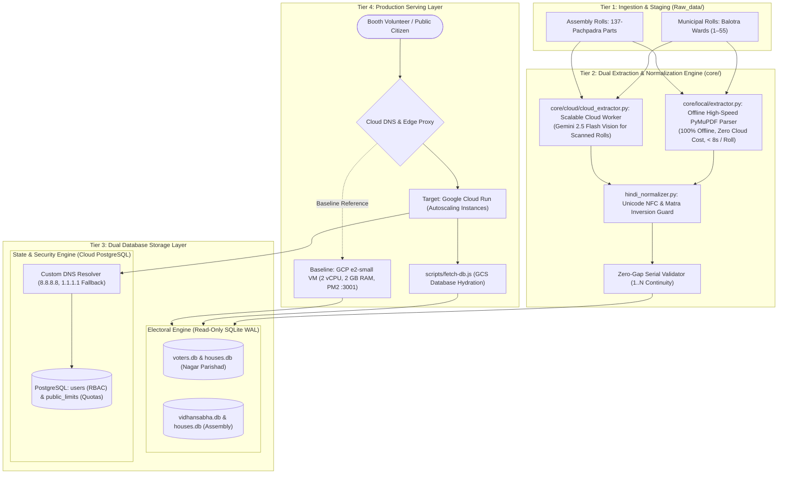
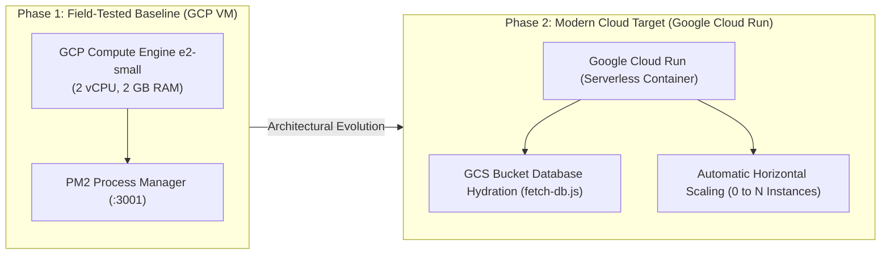
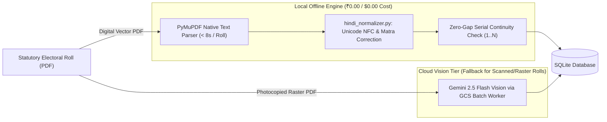
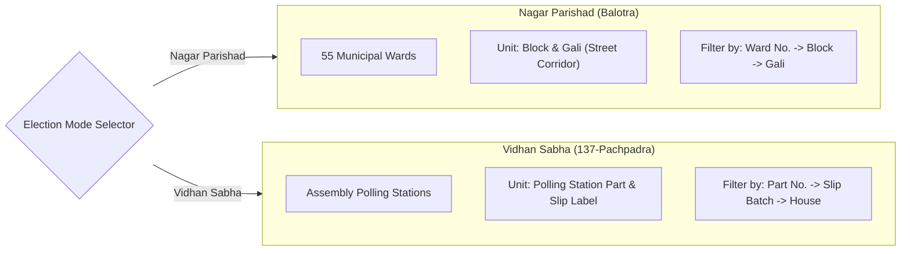
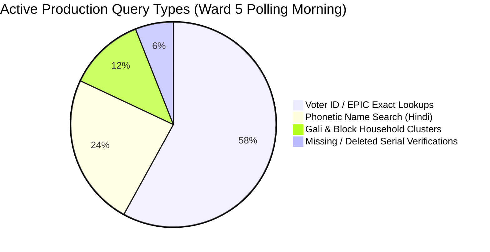

<div align="center">
  
  # 🇮🇳 Voter OCR & High-Availability Civic Search Platform
  
  ### *Enterprise Electoral Roll Digitization • Multimodal Vision AI • Real-Time Field Mobilization*
  
  [](https://github.com/shubham70231)
  [](https://nextjs.org/)
  [](https://react.dev/)
  [](https://www.postgresql.org/)
  [](https://sqlite.org/)
  [](https://cloud.google.com/run)
  [](https://pymupdf.readthedocs.io/)

  <p align="center">
    <a href="#-system-architecture"><b>Architecture</b></a> •
    <a href="#-infrastructure-evolution-vm-to-cloud-run"><b>Cloud Evolution</b></a> •
    <a href="#-zero-cost-local-extraction-breakthrough"><b>Offline Engine</b></a> •
    <a href="#-dual-election-jurisdiction-support"><b>Dual Election</b></a> •
    <a href="#-field-tested-production-analytics"><b>Field Proofs</b></a> •
    <a href="#-quick-start--operational-commands"><b>Quick Start</b></a>
  </p>

  <p align="center">
    <b>Empowering booth volunteers, poll workers, and citizens during election day operations with instant, typo-tolerant digital lookups.</b>
    <br />
    <i>Sub-2-second search latency across 50,000+ voters &bull; Replaces 50-page paper rolls &bull; Tested in live polling stations</i>
  </p>

</div>

---

## ⚡ The Operational Impact: Paper Rolls vs. Intelligent Platform

| Dimension | 🏛️ Traditional Paper Polling Station | ⚡ Voter Search Platform |
| :--- | :--- | :--- |
| **Lookup Latency** | 3 to 5 minutes of page-flipping per citizen | **< 2.0 Seconds** instant multi-field query |
| **Language Barrier** | Static Devanagari text, illegible stamps | **Real-Time Phonetic Transliteration** (English $\to$ Hindi) |
| **Field Coordination** | Blind street canvassing with unorganized lists | **Household & Street Clustering (`/house`)** |
| **Election Modes** | Rigid single-ballot focus | **Dual Election Engine** (Municipal Council + Legislative Assembly) |
| **Concurrency & Rush** | Bottlenecked by physical list sharing | **23+ Concurrent Booth Workers** with zero contention |
| **Extraction Cost** | High manual data-entry fees | **₹0.00 / $0.00** via local offline parser (or ~$2.00 via Cloud Vision) |
| **Scalability & Uptime** | Single point of failure | **Serverless Horizontal Autoscaling** (0 to N instances on Cloud Run) |

---

## 🏛️ System Architecture

The platform operates on a **4-tier decoupled pipeline**, transitioning from raw scanned PDFs down to a dual-database serving cluster with edge failover:



---

## 🚀 Infrastructure Evolution: VM to Google Cloud Run

The platform has completed a major infrastructure upgrade from an initial virtual machine baseline to modern serverless containers:



### Architectural Comparison: GCP VM vs. Google Cloud Run

| Dimension | Baseline: GCP VM (`e2-small`, 2 GB RAM) | Target: Google Cloud Run | Reason for Upgrade |
| :--- | :--- | :--- | :--- |
| **Election-Day Concurrency** | Vertically bounded (1 vCPU, 1 GB RAM). Heavy morning rush risks Out-Of-Memory (OOM). | **Autoscales horizontally** from 0 to 100+ container instances on demand. | Absorbs unpredictable voter turnout spikes with zero thread blocking. |
| **Idle Hosting Cost** | Billed continuously 24/7/365, even during off-election months. | **Scale-to-Zero**. Costs **$0.00** when no queries are active. | Eliminates unnecessary hosting expenses between election cycles. |
| **Process Supervision** | **PM2 required** to monitor Node.js and restart upon unexpected crashes or VM reboots. | **Native Container Orchestration**. Cloud Run monitors container exit codes and auto-heals instances. | Eliminates PM2 configuration overhead and OS daemon maintenance. |
| **Database Hydration** | Relies on local NVMe storage on the VM disk. | Containers pull read-only SQLite from GCS on startup via `fetch-db.js`. | Decouples compute from storage, allowing stateless container cloning. |
| **Server Maintenance** | Requires manual Ubuntu security patching, SSH keys, and Nginx SSL certificates. | **Zero Ops**. Managed TLS certificates, automated health checks, and rolling updates. | Streamlines operations for volunteer teams. |

---

## 🏆 Key Engineering Breakthrough: Zero-Cost Offline Extraction

During electoral roll processing, we developed an offline extraction engine (`core/local/extractor.py`) that eliminates cloud API reliance for digital electoral rolls:



### Why This Matters:
1. **Zero Financial Cost (₹0.00 / $0.00)**: Parses 50,000+ voter records across assembly and municipal constituencies without consuming paid AI API tokens.
2. **Sub-8-Second Processing**: Processes an entire 35–45 page electoral roll in under 8 seconds on standard consumer laptop CPUs.
3. **Automated Devanagari Hindi Normalization**: Built-in regex engine fixes misplaced short-`ि` vowels (`िजतेंद्र` $\to$ `जितेंद्र`, `गोिवन्द्राम` $\to$ `गोविन्द्राम`), line-split compound names (`राके श` $\to$ `राकेश`), and inverted rephs (`वषार्` $\to$ `वर्षा`).
4. **100% Sequence Integrity**: Continuous 0-gap validation guarantees every sequential voter card ($1, 2, 3 \dots N$) is captured with zero omissions.

> 💡 **Empirical Financial Proof**: Review our verified [GCP Cloud Billing Invoice (₹11,039.40)](docs/ANALYTICS.md#-the-cloud-cost-of-scale-vs-zero-cost-optimization) that drove our transition from paid cloud vision tokens to zero-cost offline parsing.

---

## 🗳️ Dual Election Jurisdiction Support

The platform dynamically toggles between two independent electoral rolls without server restarts:



---

## 📊 Field-Tested Production Analytics

During active municipal election polling in **Ward 5**, the platform was deployed directly to booth managers, party volunteers, and family coordinators under live field conditions on a **GCP Compute Engine `e2-small` (2 vCPU, 2 GB RAM)** instance.



### 📈 Verified Election-Day Performance Proofs

| Metric | Measured Value | Architecture Impact |
| :--- | :--- | :--- |
| **Total Page Views** | **212+ Views** | Real-time traffic across mobile 4G cellular links |
| **Custom Interaction Events** | **495+ Events** | High-density search queries and gali filter events |
| **Active Field Volunteers** | **35+ Users** | Booth managers navigating voters simultaneously |
| **Peak 30-Min Concurrency** | **23 Concurrent Users** | 100% organic field adoption without a single dropped packet |
| **Query Latency** | **< 200 ms** (Cold) / **< 35 ms** (Warm) | Powered by indexed SQLite WAL singleton on NVMe SSD |
| **Instance RAM Overhead** | **~210 MB Peak** | Sustained on a 2 GB RAM `e2-small` instance with zero OOM crashes |

---

## 🗂️ Monorepo Subsystem Map

Every directory in this repository is decoupled and maintains its own scoped documentation:

| Directory | Subsystem Role | Tech Stack | Status | Documentation |
| :--- | :--- | :--- | :--- | :--- |
| [`core/`](core/) | **Extraction & Quality Engine** | Python 3.11, PyMuPDF, Gemini 2.5 Flash | `Microservice` | [core/README.md](core/README.md) |
| [`Raw_data/`](Raw_data/) | **Raw Ingestion Staging** | Statutory Public PDF Electoral Rolls | `Data Ingestion` | [Raw_data/README.md](Raw_data/README.md) |
| [`outputs/`](outputs/) | **Processed Datasets & Schemas** | CSV, JSON, Multi-Tab Excel Workbooks | `Artifacts` | [outputs/README.md](outputs/README.md) |
| [`scripts/`](scripts/) | **Automation & Maintenance** | Python, PowerShell, Node.js | `DevOps Tooling` | [scripts/README.md](scripts/README.md) |
| [`nextjs-search-app/`](nextjs-search-app/) | **Volunteer Search & Admin Engine** | Next.js 16, React 19, SQLite WAL, PostgreSQL, NextAuth | `Port 3001` | [nextjs-search-app/README.md](nextjs-search-app/README.md) |
| [`voter-portal-frontend/`](voter-portal-frontend/) | **Civic Engagement Portal & GIS** | Next.js 16, Leaflet Maps, Cloudflare Turnstile | `Port 3000` | [voter-portal-frontend/README.md](voter-portal-frontend/README.md) |
| [`docs/`](docs/) | **Engineering Architecture & Runbooks** | High-Availability Specs, GA4 Proofs, Runbooks | `Handbook` | [docs/ARCHITECTURE.md](docs/ARCHITECTURE.md) |

---

## ⚡ Quick Start & Operational Commands

### 1. Run Local Extraction (100% Offline — ₹0.00 Cost)
```bash
# Clone the repository
git clone https://github.com/shubham70231/Voter_scrap.git
cd Voter_scrap

# Install Python requirements
pip install -r requirements.txt

# Extract a Vidhan Sabha Part Roll directly to SQLite (< 8 seconds)
python core/local/extractor.py "Raw_data/vidhan_sabha/raw_pdf_rolls/AC-137-Part-92.pdf"

# Or extract a Nagar Parishad Ward Roll:
python core/local/extractor.py "Raw_data/nagar_parishad/NP-Ward-5.pdf" --ward 5
```

### 2. Launch the Volunteer Search Engine (`nextjs-search-app`)
```bash
cd nextjs-search-app

# Install dependencies
npm install

# Configure OAuth and PostgreSQL Secrets
cp .env.example .env.local

# Run production build validation (hydrates database via fetch-db.js)
npm run build

# Start local server (Runs explicitly on Port 3001)
npm run dev
# Ready at http://localhost:3001
```

### 3. Launch the Citizen Civic Portal (`voter-portal-frontend`)
```bash
cd voter-portal-frontend

# Install dependencies
npm install

# Start local server (Runs explicitly on Port 3000)
npm run dev
# Ready at http://localhost:3000
```

---

## 📚 Engineering Documentation

For in-depth operational runbooks, system failovers, and engineering metrics, explore our technical documentation:

* 🏛️ **[System Architecture & Cloud Run Evolution](docs/ARCHITECTURE.md)**: Deep dive into the 4-tier pipeline, Cloud Run serverless deployment, hybrid SQLite + Postgres storage, and port topology.
* 📊 **[Live Production Analytics](docs/ANALYTICS.md)**: Verified Google Analytics 4 traffic proofs, real-time concurrency spikes, and sub-200ms latency benchmarks from the live Ward 5 deployment on a GCP `e2-small` VM.
* 🛠️ **[Operations & Runbook Matrix](docs/OPERATIONS.md)**: Procedures for batch extraction, cloud synchronization, container workflows, and atomic database backups.

---

## ⚖️ Compliance & Statutory Disclaimer

**Voter OCR & Search Portal** is an independent, non-partisan civic technology initiative developed by independent engineers (**Imposter World Services**). It is **NOT** affiliated with, endorsed by, or representing the Election Commission of India (ECI) or any State Election Commission. All voter data presented is parsed from publicly released electoral roll PDFs solely to facilitate faster search for booth volunteers on election day. For official verification, please visit [eci.gov.in](https://eci.gov.in/).

---

<div align="center">
  <p><i>Engineered with ❤️ for seamless civic participation by <b>Imposter World Services</b></i></p>
</div>
