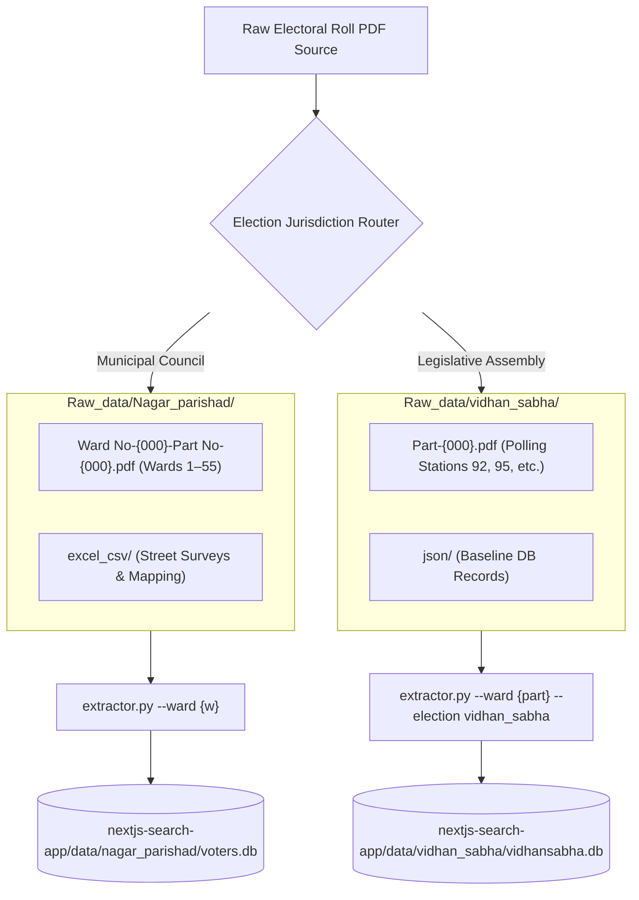

<div align="center">

# 📁 Raw Electoral Data Repository (`Raw_data/`)

**Source PDFs & Initial Documents Partitioned by Election Jurisdiction**

</div>

---

## 📖 Ingestion Architecture & Data Routing

The **`Raw_data/`** directory is the staging ground for raw, unparsed Indian Electoral Roll PDFs and initial baseline documents:



---

## 📂 Directory Layout

```
Raw_data/
├── Nagar_parishad/            # Urban Local Body (Municipal Council / Wards)
│   └── excel_csv/             # Baseline street & block surveys for municipal wards
│
└── vidhan_sabha/              # Legislative Assembly (Constituency Polling Stations)
    └── json/                  # Baseline electoral databases (Part 92, Part 95)
```

---

## 🏷️ Standard Naming Conventions

When adding new official electoral roll PDFs for processing, follow these standard naming conventions to enable automatic ward/part detection in `core/local/extractor.py`:

| Election Tier | Recommended File Pattern | Example | Destination DB |
| :--- | :--- | :--- | :--- |
| **Municipal / Nagar Parishad** | `Ward No-{000}-Part No-{000}.pdf` | `Ward No-005-Part No-001.pdf` | `data/nagar_parishad/voters.db` |
| **Vidhan Sabha / Assembly** | `AC-{Constituency}-Part-{PartNo}.pdf` | `AC-137-Part-092.pdf` | `data/vidhan_sabha/vidhansabha.db` |

---

## 🔒 Security & Privacy Notice

> [!IMPORTANT]
> - Raw electoral rolls contain public voter information. **Never commit scanned PDFs with personal photos** into public repositories.
> - Official voter roll PDFs without photographs are indexed under public domain statutory election disclosures.
> - Ensure `.gitignore` ignores all large binary PDFs (`*.pdf`) in this folder before pushing to GitHub.

---

## 🔄 Extraction Flow

To process any PDF in this directory into structured records:
```bash
# Extract Municipal Ward
python core/local/extractor.py "Raw_data/Nagar_parishad/Ward No-005-Part No-001.pdf" --ward 5

# Process Legislative Assembly Part
python core/local/extractor.py "Raw_data/vidhan_sabha/Part-092.pdf" --ward 92
```
Extracted records are automatically structured into SQLite and exported into [`outputs/`](file:///d:/IWS%20PROJECT/Voter_scrap/outputs).

---

<div align="center">
  <sub>Maintained to 1Cr Senior-Engineer Standards by <a href="https://github.com/shubham70231">IWS Engineering</a>.</sub>
</div>
