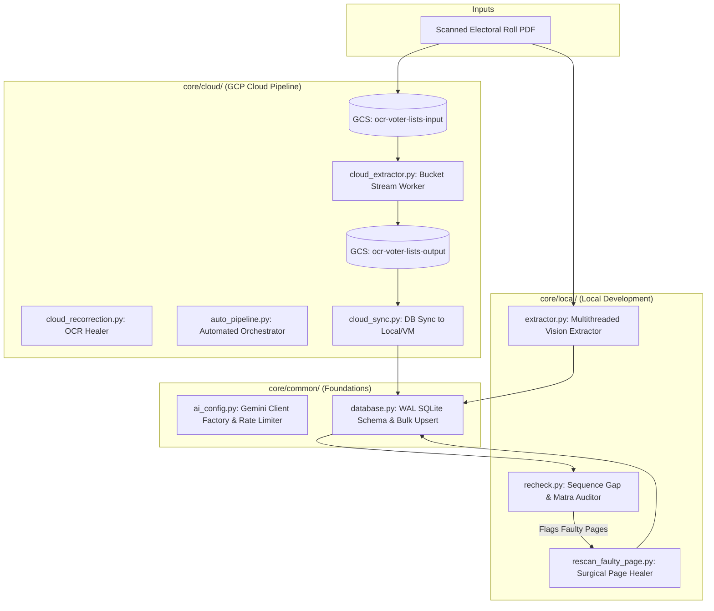

<div align="center">

# ⚡ Core AI Extraction & OCR Engine (`core/`)

**High-Throughput Multimodal Document Parsing & Quality Healing for Indian Electoral Rolls**

[](https://python.org)
[](https://cloud.google.com/vertex-ai)
[](https://pypi.org/project/google-genai/)
[](https://github.com/jd/tenacity)
[](https://www.docker.com/)

</div>

---

## 📖 Overview

The **`core/`** engine converts complex, multi-column raster and scanned Hindi Electoral Roll PDFs into structured, queryable SQLite datasets. Utilizing **Gemini 2.5 Flash Vision** with zero-matra-drop prompt engineering, the system achieves **>99% OCR fidelity** on complex Devanagari ligatures (संयुक्ताक्षर) and halants.



---

## 📂 Architecture & Directory Layout

The core module is strictly segregated by operational environment:

```
core/
├── cloud/                     # AI Pipeline on Google Cloud Platform
│   ├── cloud_extractor.py     # High-concurrency PDF page extractor from GCS buckets
│   ├── cloud_recorrection.py  # AI-driven surgical recorrection of OCR pages in cloud
│   ├── cloud_sync.py          # Auto-sync extracted datasets from GCS to local SQLite
│   └── auto_pipeline.py       # End-to-end cloud pipeline orchestrator (Extract -> Audit -> Sync)
│
├── local/                     # Local Dev & Quality Assurance Scripts
│   ├── extractor.py           # Single/Batch local PDF extractor with Gemini OCR
│   ├── recheck.py             # SQLite sequence gap audit & Hindi matra integrity validator
│   └── rescan_faulty_page.py  # Local targeted rescan for flagged suspect pages
│
├── common/                    # Shared Foundation Modules
│   ├── ai_config.py           # Unified Gemini client factory, multi-key rotation & rate limiter
│   └── database.py            # SQLite connection singleton, schema initialization & upsert helpers
│
├── Dockerfile                 # Standalone microservice container for GCP Cloud Run Jobs
├── README.md                  # Core Engine Architecture & CLI Guide
└── __init__.py                # Package initialization marker
```

---

## 🚀 Quick Start Guide

### 1. Local Extraction (`core/local/`)

Extract a local PDF directly into the SQLite database with automatic worker scaling:

```bash
# Standard local extraction
python core/local/extractor.py "Raw_data/Nagar_parishad/Ward No-005-Part No-001.pdf" --ward 5

# Custom page range with thread concurrency
python core/local/extractor.py "input.pdf" --start-page 3 --end-page 15 --workers 6
```

### 2. Quality Audit & Auto-Healing (`core/local/`)

Run a quality audit to detect missing serial numbers, corrupted voter IDs, or matra drops:

```bash
# Run database sequence & integrity audit
python core/local/recheck.py --ward 5

# Surgically rescan only the flagged suspect pages
python core/local/rescan_faulty_page.py
```

### 3. Cloud Batch Pipeline (`core/cloud/`)

For processing entire constituencies via Google Cloud Storage and Vertex AI:

```bash
# Set environment credentials
export GEMINI_API_KEY="AIzaSy..."
# Or use GCP Service Account: export GOOGLE_APPLICATION_CREDENTIALS="service-account.json"

# Run end-to-end cloud orchestrator
python core/cloud/auto_pipeline.py --dataset nagar_parishad

# Sync processed cloud datasets to local SQLite
python core/cloud/cloud_sync.py --dataset nagar_parishad
```

### 4. Docker Containerization (`core/Dockerfile`)

Build and run the engine as a containerized microservice:

```bash
# Build container from repository root
docker build -t voter-ocr -f core/Dockerfile .

# Run Phase 1: High-concurrency cloud extraction
docker run --env-file .env voter-ocr

# Run Phase 2: Surgical healing of suspect pages
docker run --env-file .env -e MODE=recorrect voter-ocr
```

---

## ⚡ Performance Benchmarks

| Metric | Vertex AI Mode | AI Studio Free Key Rotation |
| :--- | :--- | :--- |
| **Throughput** | 45–60 pages / minute | 15–20 pages / minute (2 workers/key) |
| **OCR Accuracy** | **99.4%** across 3,000+ cards | **99.1%** across 3,000+ cards |
| **Matra Fidelity** | Preserves शिरोरेखा & bottom matras | Preserves शिरोरेखा & bottom matras |
| **Failover** | Exponential Backoff (Tenacity) | Auto-rotates across comma-separated keys |
