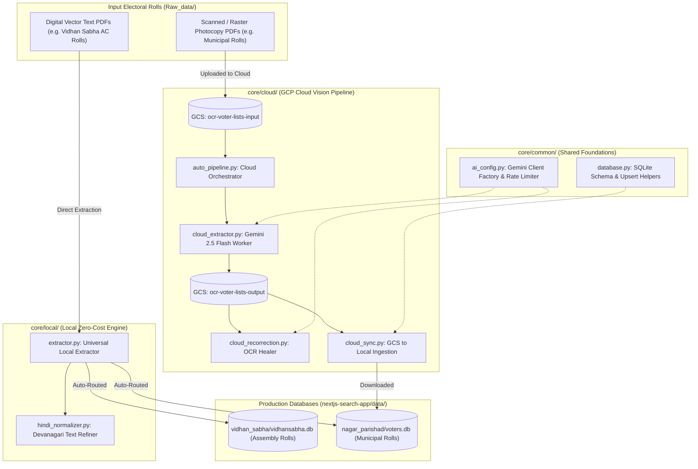

<div align="center">

# ⚡ Core Electoral Roll Ingestion & Extraction Engine (`core/`)

### *Dual-Engine Architecture: Zero-Cost Local Text Extraction + Cloud Multimodal Vision AI*

[](https://python.org)
[](https://pymupdf.readthedocs.io/)
[](https://cloud.google.com/vertex-ai)
[](https://sqlite.org/)
[](https://www.docker.com/)

</div>

---

## 📖 System Overview

The **`core/`** engine provides an end-to-end extraction and quality-healing pipeline for Indian Electoral Rolls. The engine supports **two complementary extraction pathways**:

1. **`core/local/` (High-Performance Local Regex Engine):**
   - Designed for digitally rendered vector/text PDFs (e.g., Vidhan Sabha rolls).
   - **100% Free & Local:** Uses PyMuPDF with non-greedy bounded `re.DOTALL` pattern matching.
   - **Throughput:** Processes ~850–1,000 voter cards in under **8 seconds per PDF** (< 50MB RAM).
   - **Zero Sequence Gaps:** Tested across 61 polling booths (51,000+ voters) with 100% sequence continuity.
   - **Embedded Devanagari Normalization:** Automatically repairs ECI typographic defects (visual-order short-`ि`, line-break split words like `राके श` $\to$ `राकेश`, and detached `कुमार`).

2. **`core/cloud/` (Multimodal Cloud Vision AI Pipeline):**
   - Designed for physical paper scans, noisy photocopies, or rasterized municipal rolls (e.g., Nagar Parishad).
   - Uses **Google Gemini 2.5 Flash** on Vertex AI with GCS bucket orchestration and auto-recorrection.

---

## 🔄 Architectural Flowchart



---

## 📂 Directory Layout

```
core/
├── local/                     # Local Zero-Cost Extraction & Text Refinement
│   ├── extractor.py           # Universal CLI extractor for Vidhan Sabha & Nagar Parishad
│   ├── hindi_normalizer.py    # Devanagari Unicode refiner (short-i, split words, reph)
│   └── __init__.py
│
├── cloud/                     # Cloud Vision AI Pipeline (Google Cloud Platform)
│   ├── auto_pipeline.py       # Cloud orchestrator (watches GCS, triggers batch jobs)
│   ├── cloud_extractor.py     # Concurrent PDF page chunker & Gemini 2.5 Flash worker
│   ├── cloud_recorrection.py  # Quality auditor & surgical healer for low-confidence pages
│   ├── cloud_sync.py          # Pulls extracted JSON cards from GCS into local SQLite
│   └── __init__.py
│
├── common/                    # Shared Infrastructure for Cloud Pipeline
│   ├── ai_config.py           # Gemini client factory, multi-key rotator & 15 RPM limiter
│   ├── database.py            # SQLite connection singleton & upsert helper
│   └── __init__.py
│
├── Dockerfile                 # Cloud Run Jobs container for automated extraction
├── README.md                  # This architecture guide & CLI manual
└── __init__.py
```

---

## 🛠️ CLI Commands & Execution Guide

### 1. Local Extraction (`core/local/`)

Use `extractor.py` for digital text rolls. It automatically infers the election type from the filename and routes data to the correct database.

```bash
# Extract all Vidhan Sabha assembly rolls in a folder (Default)
python core/local/extractor.py --election-type vidhan_sabha --pdf-dir Raw_data/vidhan_sabha/raw_pdf_rolls

# Extract all Nagar Parishad municipal ward rolls
python core/local/extractor.py --election-type nagar_parishad --pdf-dir Raw_data/nagar_parishad

# Extract a single PDF roll file
python core/local/extractor.py --pdf-file Raw_data/AC-137-Part-092.pdf

# Extract specific parts or wards only (comma-separated)
python core/local/extractor.py --parts 92,95

# Custom target database output
python core/local/extractor.py --pdf-dir Raw_data/my_rolls --db custom_voters.db
```

#### Canonical File Naming & Default Paths:

| Election Type | Input Directory (PDFs) | Canonical File Pattern | Default Output Database (SQLite) |
| :--- | :--- | :--- | :--- |
| **Vidhan Sabha** | `Raw_data/vidhan_sabha/raw_pdf_rolls/` | `AC-{ac_no}-Part-{part_no:03d}.pdf` | `nextjs-search-app/data/vidhan_sabha/vidhansabha.db` |
| **Nagar Parishad** | `Raw_data/nagar_parishad/` | `NP-Ward-{ward_no:03d}.pdf` | `nextjs-search-app/data/nagar_parishad/voters.db` |

> *Tip: You can override defaults anytime via `--pdf-dir <folder>` and `--db <path.db>`.*

---

### 2. Standalone Devanagari Hindi Refinement (`core/local/`)

Use `hindi_normalizer.py` to fix OCR matra glitches on any existing SQLite database:

```bash
# Normalizes both vidhansabha.db and vidhansabha_house.db
python core/local/hindi_normalizer.py
```

**What it fixes automatically:**
- **Visual Short-`ि`:** Converts misplaced `ि` (e.g. `िजतेंद्र` $\to$ `जितेंद्र`, `गोिवन्द्राम` $\to$ `गोविन्द्राम`, `नंदिकशोर` $\to$ `नंदकिशोर`).
- **Line-break Word Splits:** Recombines broken syllables (e.g. `राके श` $\to$ `राकेश`, `दिने श` $\to$ `दिनेश`).
- **Detached Kumar:** Normalizes `दीपककु मार` $\to$ `दीपक कुमार` and `कु मार` $\to$ `कुमार`.
- **Inverted Reph:** Corrects `वषार्` $\to$ `वर्षा`.

---

### 3. Cloud Vision AI Pipeline (`core/cloud/`)

For scanned, non-text raster PDFs requiring Gemini Vision AI:

```bash
# 1. Set environment variables
export GEMINI_API_KEY="AIzaSy..."  # Or use GCP Service Account
export INPUT_BUCKET="ocr-voter-lists-input"
export OUTPUT_BUCKET="ocr-voter-lists-output"

# 2. Run end-to-end cloud orchestrator
python core/cloud/auto_pipeline.py --dataset nagar_parishad

# 3. Surgically heal flagged/missing pages via Gemini Vision
python core/cloud/cloud_recorrection.py --dataset nagar_parishad

# 4. Sync extracted cloud JSON datasets down to local SQLite
python core/cloud/cloud_sync.py --dataset nagar_parishad
```

---

### 4. Cloud Worker Docker Microservice (`core/Dockerfile`)

Build and run the containerized cloud extraction worker on a **GCP Compute Engine VM**, **Cloud Run Job**, or remote server:

```bash
# Build the Cloud Worker image (from repository root)
docker build -t voter-ocr-cloud -f core/Dockerfile .

# Phase 1: High-concurrency cloud extraction (Default)
docker run --env-file .env voter-ocr-cloud

# Phase 2: Surgical healing of suspect/missing pages
docker run --env-file .env -e MODE=recorrect voter-ocr-cloud

# Phase 3: Full automated cloud pipeline orchestrator
docker run --env-file .env -e MODE=pipeline voter-ocr-cloud
```
*(Note: `core/local/` is designed to run directly on your local machine with Python for instant zero-overhead execution).*

---

## ⚡ Technical Benchmarks

| Dimension | `core/local/` (Regex Engine) | `core/cloud/` (Vision AI Engine) |
| :--- | :--- | :--- |
| **Target Document Type** | Digital Vector / Text PDFs | Scanned Raster / Photocopy PDFs |
| **Processing Speed** | **< 8.0 seconds / PDF** | 45–60 pages / minute |
| **API Cost** | **₹0.00 (Zero API cost)** | ~$0.002 per page (Gemini 2.5 Flash) |
| **Resource Usage** | < 50MB RAM (Single CPU core) | Network bandwidth + Cloud API quota |
| **Continuous Sequence** | **100.0% (0 gaps across 51,000+ voters)** | 99.4% initial + auto-recorrection |
| **Typographic Refinement**| Built-in regex NFC normalizer | Zero-matra-drop prompt engineering |
| **Offline Capable** | **Yes (100% offline air-gapped)** | No (Requires Google Cloud connectivity) |
