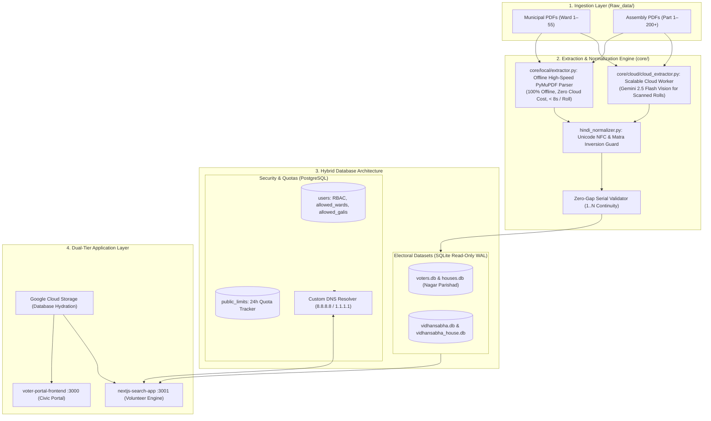
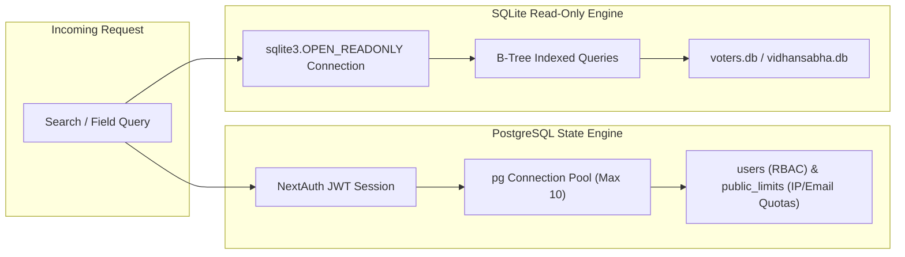
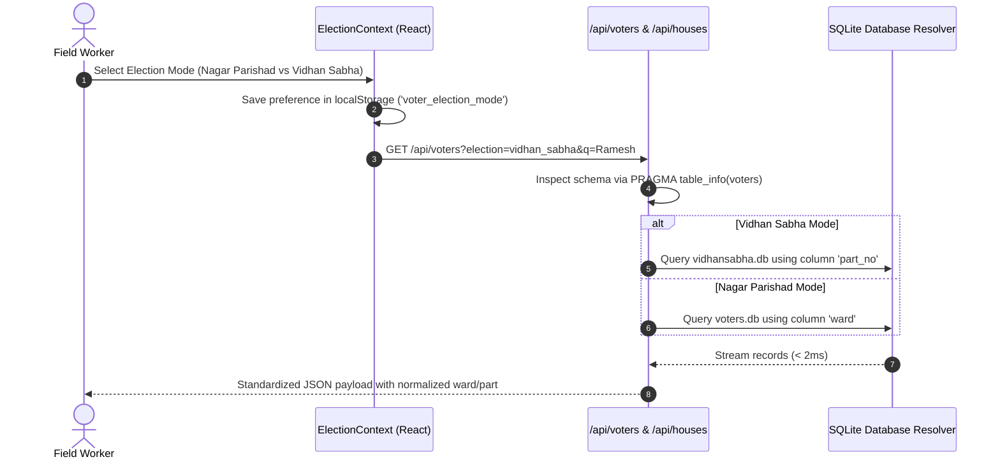
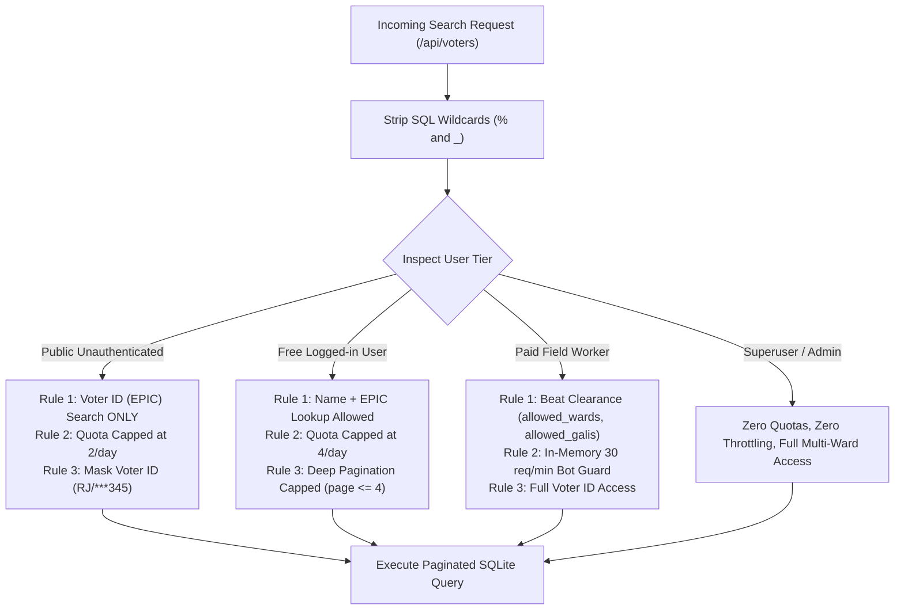
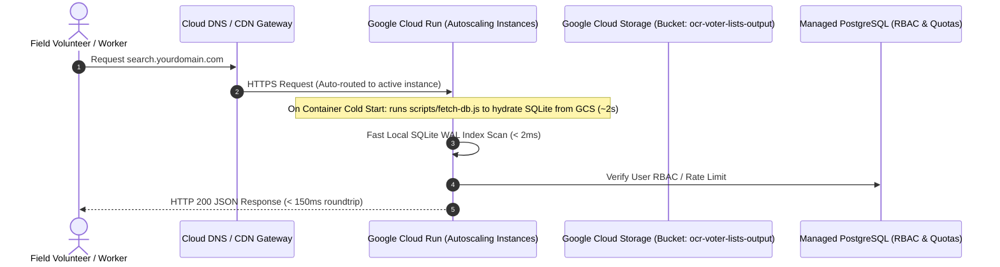

# 🏛️ System Architecture & Infrastructure Specification

> **Organization**: Imposter World Services (IWS)  
> **System**: Voter Scrap (Electoral Roll Digitization & Volunteer Field Engine)  
> **Standard**: High-Availability System Architecture Specification

---

## 1. High-Level Subsystem Topology

The system is organized into decoupled, single-responsibility layers connecting data ingestion to field volunteer mobile interfaces:



---

## 2. Hybrid Dual-Database Storage Architecture

To achieve both **ultra-low search latency (< 2ms)** and **secure multi-instance state synchronization**, the system employs a hybrid storage strategy:



### A. Electoral Data Engine (SQLite Read-Only WAL)
* **Locations**: 
  - `nextjs-search-app/data/nagar_parishad/voters.db` & `houses.db`
  - `nextjs-search-app/data/vidhan_sabha/vidhansabha.db` & `vidhansabha_house.db`
* **Concurrency Pattern**: Thread-safe singleton initialized via `openReadonlyDb()` in `src/utils/dbPath.ts`.
* **Pragmas**:
  ```sql
  PRAGMA journal_mode = WAL;
  PRAGMA busy_timeout = 5000;
  PRAGMA synchronous = NORMAL;
  PRAGMA cache_size = -64000; -- 64MB In-Memory Cache
  ```
* **Why Read-Only SQLite?**: Eliminates all database locking. Hundreds of concurrent booth workers can execute read queries in parallel directly off the SSD with zero network hops.

### B. Security & Rate-Limiting Engine (PostgreSQL)
* **Location**: Centralized Cloud PostgreSQL (Neon / Supabase / Cloud SQL) configured in `src/lib/db.ts`.
* **Resilient DNS Fallback**: Direct integration of `dns.Resolver` pointed to Google Public DNS (`8.8.8.8`, `1.1.1.1`) bypassing local Windows or ISP DNS resolution drops for cloud connection strings.
* **Tables**:
  - `users`: Manages Google OAuth logins, assigned role (`developer`, `admin`, `paid`, `user`), and assigned beats (`allowed_wards`, `allowed_galis`).
  - `public_limits`: Tracks persistent 24-hour quota sliding windows by IP (`ip:x.x.x.x`) or user email (`user:email@domain.com`).

---

## 3. Dual Election Roll Architecture

The platform supports two independent electoral jurisdictions switchable on the fly via `ElectionContext`:



---

## 4. Anti-Scraping & Privacy Defense Tier

To prevent unauthorized mass harvesting of voter data by automated bots:



---

## 5. Serving Infrastructure & Cloud Run Evolution

The platform was initially field-tested on a **GCP Compute Engine `e2-small` VM (2 vCPU, 2 GB RAM)** using PM2 for daemon supervision. To accommodate massive election-day concurrency surges without manual server provisioning, the production serving target is transitioning to **Google Cloud Run (Serverless Containers)**.



### Infrastructure Comparison: GCP VM vs. Google Cloud Run

| Architectural Dimension | Baseline: GCP VM (`e2-small`, 2 GB RAM) | Target: Google Cloud Run |
| :--- | :--- | :--- |
| **Process Supervision** | **PM2 Daemon** required to auto-revive Node.js on crash or VM reboot. | **Native Container Orchestrator** auto-revives crashed instances without PM2. |
| **Concurrency Scaling** | Fixed to single instance (1 vCPU, 1 GB RAM); risks Out-Of-Memory under heavy volunteer surges. | **Dynamic Horizontal Autoscaling** from 0 to 100+ container instances on demand. |
| **Idle Cost** | Incurred 24/7/365 continuous billing even during non-election periods. | **Scale-to-Zero** ($0.00 idle cost outside polling hours). |
| **Database Hydration** | Local persistent NVMe disk storage. | Container pulls read-only SQLite from GCS on startup via `fetch-db.js`. |
| **Operational Maintenance** | Requires manual Ubuntu security patches, SSH key rotation, and Nginx SSL setup. | **Zero Ops**: Google handles OS updates, networking, and automatic TLS certification. |

---

## 6. Port & Local Development Topology

To guarantee zero port drift and eliminate OAuth callback mismatches:

| Subsystem | Local Dev Port | Production Binding | Role |
| :--- | :--- | :--- | :--- |
| **`voter-portal-frontend`** | `http://localhost:3000` | Vercel Edge CDN | Public Citizen Portal (GIS Map, Turnout, Candidates) |
| **`nextjs-search-app`** | `http://localhost:3001` | GCP VM (PM2 :3001) | Volunteer Field Search & Gali Mobilization Engine |

---

<div align="center">
  <sub>Maintained by <a href="https://github.com/shubham70231">IWS Engineering</a>. Standard Operating Architecture.</sub>
</div>
