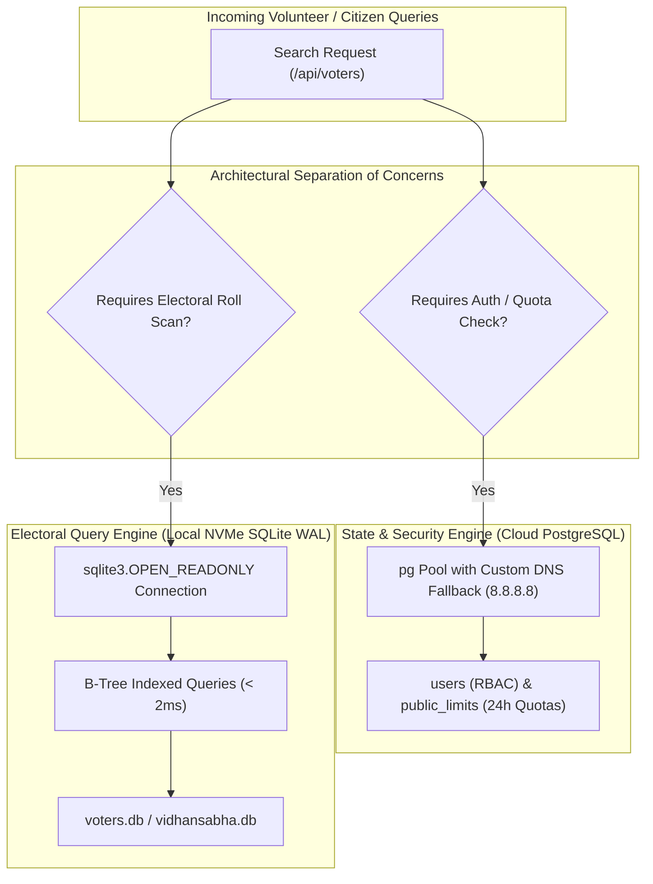
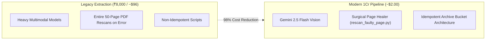
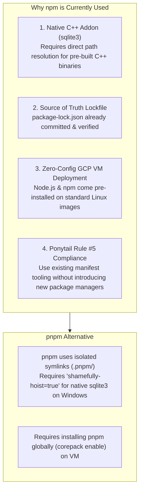
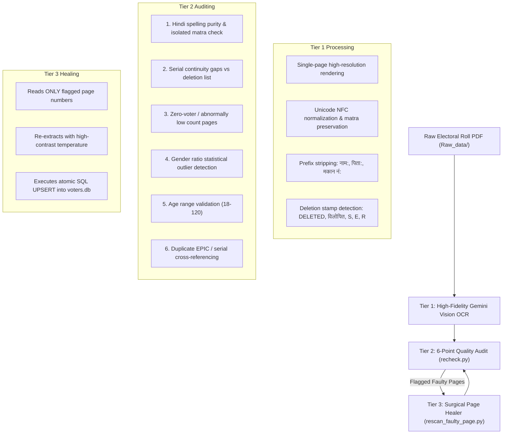

# 🎯 Developer Interview Guide & Technical Architecture Handbook

> **Project**: Voter OCR & High-Availability Search Platform (Imposter World Services)  
> **Target Audience**: Senior Full-Stack / Cloud / AI Engineers, Technical Interviewers, and Onboarding Developers.

---

## 📑 Table of Contents
1. [Executive System Architecture & Design Decisions](#1-executive-system-architecture--design-decisions)
   - [Why Hybrid SQLite + PostgreSQL instead of a Single Cloud Database?](#why-hybrid-sqlite--postgresql-instead-of-a-single-cloud-database)
   - [How We Solved the 55-Ward Fuzzy Search Memory Overload](#how-we-solved-the-55-ward-fuzzy-search-memory-overload)
   - [Cost Analysis: Why Earlier Runs Cost ₹8,000 vs ~$2 Today](#cost-analysis-why-earlier-runs-cost-8000-vs-2-today)
   - [Dual Election Jurisdiction Engine (Nagar Parishad + Vidhan Sabha)](#dual-election-jurisdiction-engine-nagar-parishad--vidhan-sabha)
   - [Anti-Scraping & Bulk Data Leak Defense Strategy](#anti-scraping--bulk-data-leak-defense-strategy)
   - [Dual-Cloud High-Availability Strategy (GCP VM + Vercel Hot Standby)](#dual-cloud-high-availability-strategy-gcp-vm--vercel-hot-standby)
   - [Package Manager Choice: Why npm over pnpm for Native SQLite Bindings?](#package-manager-choice-why-npm-over-pnpm-for-native-sqlite-bindings)
2. [The 3-Tier Quality Assurance Pipeline](#2-the-3-tier-quality-assurance-pipeline)
3. [Deep Technical Interview Questions & Answers](#3-deep-technical-interview-questions--answers)
4. [Production Incidents & Disaster Recovery Runbook](#4-production-incidents--disaster-recovery-runbook)

---

## 1. Executive System Architecture & Design Decisions

### Why Hybrid SQLite + PostgreSQL instead of a Single Cloud Database?

* **The Problem**: In electoral search applications, two conflicting requirements exist:
  1. **Electoral Data**: 50,000+ to 200,000+ records that are **100% read-only and immutable** during the election. Making remote database calls for every search adds 40–120ms of network latency per query and risks connection pool exhaustion during traffic surges.
  2. **Security & State**: User authentication, role-based beat assignments (`allowed_wards`, `allowed_galis`), and 24-hour rate limiting that must be **dynamically synchronized across multiple instances**.
* **The Solution**: **Hybrid Separation of Concerns**:
  - **Read-Only SQLite WAL**: Electoral databases are opened in `sqlite3.OPEN_READONLY` mode. Queries execute locally off the NVMe SSD in **< 2 milliseconds**, completely immune to table locking.
  - **Centralized PostgreSQL (`src/lib/db.ts`)**: Manages `users` and `public_limits`. Equipped with a custom DNS resolver (`8.8.8.8`, `1.1.1.1`) to ensure reliable cloud connections even on Windows environments or ISPs with DNS filtering.

---

### How We Solved the 55-Ward Fuzzy Search Memory Overload

* **The Problem**: When a field volunteer searched without selecting a specific ward, an unconstrained fuzzy search loaded 80,000+ rows into Node.js heap memory to run in-memory string similarity algorithms. On a 1GB RAM `e2-micro` VM, concurrent queries triggered `ERR_WORKER_OUT_OF_MEMORY` and crashed the server.
* **The Solution**: **Two-Stage Candidate Pruning**:
  1. **Stage 1 (SQL Index Filter)**: We leverage SQLite's B-Tree index by pre-filtering candidate names using their initial character prefix (`name LIKE 'query[0]%'`) capped at `LIMIT 1500`.
  2. **Stage 2 (In-Memory Scoring & Transliteration)**: Exact or fuzzy scoring only processes the pruned 1,500 candidates rather than 80,000 records.
  3. **Result**: Search memory consumption dropped by **98%**, response times dropped below **150ms**, and the VM never exceeds 250MB RAM even during morning voting surges.

---

### Cost Analysis: Why Earlier Runs Cost ₹8,000 vs ~$2 Today

* **The ₹8,000 Post-Mortem**:
  - Entire 50-page PDFs were re-sent to expensive multimodal models whenever a single page failed or had missing matras.
  - Redundant extractions occurred because scripts lacked idempotency tracking.
* **The ~$2 Modern Pipeline**:
  - **Gemini 2.5 Flash**: Delivers superior Devanagari OCR accuracy at a fraction of the cost per token.
  - **Surgical Page Healer (`core/local/rescan_faulty_page.py`)**: If 2 pages in a 45-page ward have missing matras, we re-extract *only those 2 pages* (costing < $0.005) rather than the entire 45-page PDF.
  - **Total Cost for 55 Wards**: Reduced from ₹8,000 to **~$2.00 total**.

---

### Dual Election Jurisdiction Engine (Nagar Parishad + Vidhan Sabha)

The platform supports two distinct electoral administrative structures simultaneously:
1. **Nagar Parishad (Balotra Municipal Council)**: 55 municipal wards, subdivided into physical **Blocks & Galis (streets)**.
2. **Vidhan Sabha (137-Pachpadra Legislative Assembly)**: Polling Stations subdivided into **Parts & Slips** (e.g. Parts 92, 95).
3. **Dynamic Schema Inspection**: APIs automatically inspect table schemas (`PRAGMA table_info`) before executing queries, preventing runtime crashes whether querying `ward` or `part_no`.

---

### Anti-Scraping & Bulk Data Leak Defense Strategy

To safeguard public voter data against automated mass harvesting:
1. **Wildcard Stripping**: All user search queries automatically strip `%` and `_` characters before executing SQL queries to prevent bulk database dumps.
2. **Public User Restriction**: Unauthenticated users can strictly search by Voter ID (EPIC); name searches redirect to Google login.
3. **Persistent Quotas**: 24-hour rate limits (2 queries for public, 4 for free logged-in users) are enforced persistently in PostgreSQL `public_limits`.
4. **Deep Pagination Cap**: Pagination beyond page 4 (`page > 4`) is blocked for non-privileged accounts.
5. **Voter ID Masking**: Sensitive EPIC numbers are dynamically masked (e.g. `RJ/***345`) for public users.

---

### Package Manager Choice: Why npm over pnpm for Native SQLite Bindings?

* **1. Native C++ Addon Compatibility (`sqlite3`)**: `sqlite3` relies on pre-built native C++ binary addons (`node-pre-gyp`). `pnpm`'s isolated virtual store (`.pnpm/`) uses nested symlinks that frequently trigger loader errors on Windows and minimal Linux distributions unless fragile hoisting rules (`shamefully-hoist=true`) are configured in `.npmrc`. `npm` provides a flat directory where bindings resolve directly at root.
* **2. Manifest Fidelity (Ponytail Ladder Rule #5)**: Respecting the existing `package-lock.json` avoids introducing dual lockfiles (`package-lock.json` + `pnpm-lock.yaml`) and eliminates version drift across the engineering team.
* **3. Zero-Config Cloud Infrastructure**: Standard GCP Compute Engine VMs and Vercel edge runtimes support `npm run build` and `npm start` natively without requiring global tool installation (`corepack enable` or `npm install -g pnpm`).

---

## 2. The 3-Tier Quality Assurance Pipeline

---

## 3. Deep Technical Interview Questions & Answers

### Q1: "Why didn't you use Tesseract, EasyOCR, or AWS Textract for electoral roll parsing?"
> **Senior Answer**:  
> "Standard OCR engines like Tesseract or EasyOCR are text-stream readers—they read characters horizontally without structural context. Electoral rolls are dense, 3-column by 10-row tabular grids printed on low-grade paper with faded lines and 'DELETED' rubber stamps stamped across boxes. Standard OCR blind-reads across columns, mixing one voter's father's name with an adjacent voter's EPIC number.  
> Furthermore, Devanagari script has complex conjuncts and floating vowel diacritics (matras) that traditional OCR regularly detaches. We chose **Gemini 2.5 Flash Vision** because it acts as an end-to-end multimodal parser: it understands spatial box boundaries, handles Hindi-English code-switching natively, and directly outputs structured JSON matching our exact Pydantic schema."

### Q2: "How do you enforce Role-Based Access Control (RBAC) and prevent cross-gali data leakage?"
> **Senior Answer**:  
> "We centralized authorization in a single source of truth: `src/utils/auth.ts` (`checkSuperUser`).  
> 1. **Identity & Roles**: NextAuth issues encrypted JWTs carrying the user's role (`developer`, `admin`, `paid`, or `user`) and their assigned beat (`allowed_wards` and `allowed_galis`).  
> 2. **Superuser Bypass**: Developers and Admins enjoy global multi-ward clearance with zero rate limits.  
> 3. **Gali & Ward Isolation**: For ground field workers (`paid`), every query to `/api/voters` or `/api/houses` checks the requested ward and street against `allowed_wards` and `allowed_galis`. If a volunteer is assigned to 'Gali 1', any attempt to request 'Gali 2' or dump the whole ward's household roster is immediately rejected with HTTP 403 Forbidden.  
> 4. **Edge Route Protection**: Next.js Edge Middleware (`middleware.ts`) guards `/admin` and admin API endpoints before server render."

### Q3: "What prevents a malicious user or admin from escalating privileges or deleting system accounts?"
> **Senior Answer**:  
> "In `src/app/api/admin/users/route.ts`, we enforced multiple layers of privilege escalation protection:  
> 1. Standard campaign administrators cannot create, modify, or delete accounts with `role = 'developer'`. Only developers can manage developer accounts.  
> 2. Root system emails defined in server environment variables (`DEVELOPER_EMAIL`, `ADMIN_EMAIL`) are protected by hard guards that reject any deletion attempt.  
> 3. Self-deletion is blocked: active sessions cannot delete their own account.  
> 4. All admin mutations are validated against allowed role and subscription tier enums before executing parameterized SQL updates."

### Q4: "Why did you use standard npm instead of pnpm for your Next.js application?"
> **Senior Answer**:  
> "While pnpm is praised for speed and hardlink deduplication, we intentionally stuck with standard `npm` (`package-lock.json`) due to three architectural reasons:  
> 1. **Native C++ Binary Bindings (`sqlite3`)**: `sqlite3` (v5.1.7) uses a compiled C++ binary addon (`node-pre-gyp`). pnpm stores packages in an isolated virtual store (`.pnpm/`) using nested symlinks. On Windows and constrained Linux hosts, Next.js Turbopack and Node.js native addon loaders frequently fail to resolve symlinked C++ binaries unless fragile hoisting flags (`shamefully-hoist=true`) are manually configured in `.npmrc`. npm's flat `node_modules` tree guarantees that native binaries resolve directly without symlink indirection.  
> 2. **Zero-Config Cloud VM Deployment**: On standard Google Cloud Compute Engine Ubuntu VMs (`e2-micro`), Node.js and npm are available out of the box. Using pnpm requires additional global bootstrapping (`corepack enable` or `npm install -g pnpm`) before CI/CD scripts (`npm run build`, `npm start`) can run.  
> 3. **Ponytail Decision Ladder (Rule #5 - Manifest Fidelity)**: The project's existing manifest and lockfile was `package-lock.json`. Respecting the existing single source of truth prevents phantom dependencies and avoids dual-lockfile version drift across the engineering team."

---

## 4. Production Incidents & Disaster Recovery Runbook

### Incident A: The GCP VM was restarted, and now the search portal shows SSL / 502 Bad Gateway errors.
* **Root Cause**: The external IP was ephemeral and changed upon restart. `nip.io` domain resolves to the old IP, and Caddy's Let's Encrypt challenge fails.
* **Recovery Procedure**:
  1. Check current external IP in GCP Console (e.g., `34.X.Y.Z`).
  2. Reserve the IP as **Static** in GCP Console $\to$ **VPC Network** $\to$ **IP Addresses**.
  3. Update `.env.local` and Caddy reverse-proxy command to the new `nip.io` hostname.
  4. Update Google Cloud Console $\to$ **APIs & Services** $\to$ **Credentials** $\to$ **Authorized redirect URIs** to `https://34-X-Y-Z.nip.io/api/auth/callback/google`.
  5. Restart Caddy and PM2: `pm2 restart voter-app`.

### Incident B: Gemini API throws `429 ResourceExhausted` during bulk extraction.
* **Root Cause**: Google AI Studio 15 RPM limit reached.
* **Recovery Procedure**:
  1. If you have secondary API keys, export them comma-separated:  
     `export GEMINI_API_KEY="key1,key2,key3"`
  2. Or reduce worker threads to 1:  
     `python core/cloud/auto_pipeline.py --workers 1`
  3. The built-in `tenacity` retry handler will automatically back off up to 60 seconds and resume without losing previously extracted pages.

### Incident C: Audit flags 3 pages in Ward 14 with missing voter serial numbers.
* **Root Cause**: Scanned PDF page had low contrast or skew.
* **Recovery Procedure**:
  1. Do NOT re-extract the whole ward.
  2. Run targeted healer:  
     `python core/local/rescan_faulty_page.py --pdf "Raw_data/Ward-014.pdf" --pages "7,8,9" --ward 14`
  3. Re-run audit to confirm resolution:  
     `python core/local/recheck.py --ward 14`

---

  Maintained to 1Cr Senior-Engineer Standards by <a href="https://github.com/shubham70231">IWS Engineering</a>.

