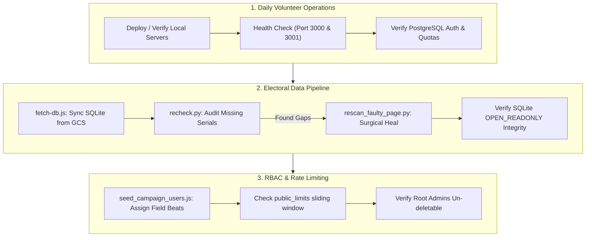
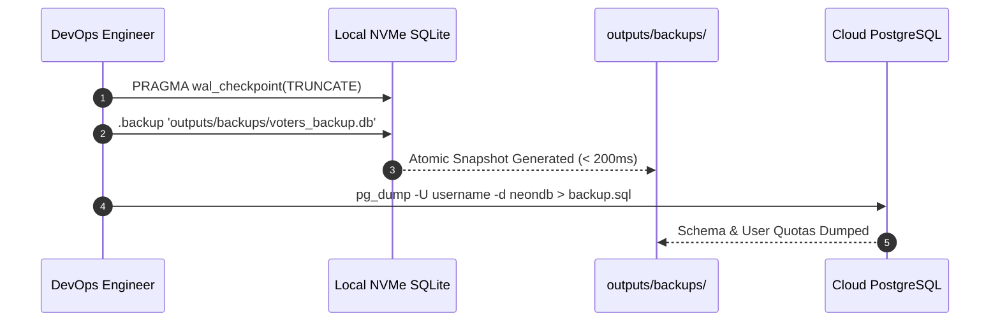

# 🛠️ Operations, Maintenance & Runbook Cheatsheet

> **Organization**: Imposter World Services (IWS)  
> **System**: Voter Scrap Production Operations  
> **Standard**: 1Cr Senior-Engineer Maintenance Protocol

---

## 1. Operational Maintenance Lifecycle



---

## 2. Quick Operations Matrix

| Task | Target Directory | Command | Expected Output |
| :--- | :--- | :--- | :--- |
| **Run Volunteer Search (Dev)** | `nextjs-search-app/` | `npm run dev` | Boots on `http://localhost:3001` |
| **Run Citizen Portal (Dev)** | `voter-portal-frontend/` | `npm run dev` | Boots on `http://localhost:3000` |
| **Build Search App (Prod)** | `nextjs-search-app/` | `npm run build` | Compiles Turbopack, 0 errors |
| **Build Citizen Portal (Prod)**| `voter-portal-frontend/` | `npm run build` | Prerenders 11/11 pages, 0 errors |
| **Initialize Cloud Auth DB** | `nextjs-search-app/` | `node scripts/init_auth_db.js` | Tables created & superusers seeded in PostgreSQL |
| **Seed Field Campaign Users** | `nextjs-search-app/` | `node scripts/seed_campaign_users.js` | Paid users created with ward/gali beat clearance |
| **Sync SQLite Users to Postgres**| `nextjs-search-app/`| `node scripts/seed_from_sqlite.js` | Legacy auth.db records migrated to PostgreSQL |
| **Sync GCS Electoral DBs** | `nextjs-search-app/` | `node scripts/fetch-db.js` | Downloads voters.db & vidhansabha.db from GCS |
| **Extract Single PDF (Local)** | `Voter_scrap/` (Root) | `python core/local/extractor.py "Raw_data/Ward-005.pdf" --ward 5` | Structured records inserted into SQLite |
| **Audit Ward Quality** | `Voter_scrap/` (Root) | `python core/local/recheck.py --ward 5` | 6-point audit report generated |
| **Surgical Page Rescan** | `Voter_scrap/` (Root) | `python core/local/rescan_faulty_page.py --pdf "Raw_data/Ward-005.pdf" --pages "3,5" --ward 5` | Flagged pages healed in DB |

---

## 3. Database Maintenance & RBAC Administration

### A. Initializing and Verifying PostgreSQL Auth Schema
```bash
# Run from nextjs-search-app/
node scripts/init_auth_db.js
```
- **What it does**: Creates `users` (with columns `name`, `email`, `role`, `subscription_tier`, `allowed_wards`, `allowed_galis`) and `public_limits` tables in cloud PostgreSQL. Automatically seeds `DEVELOPER_EMAIL` and `ADMIN_EMAIL`.
- **Side effects**: Creates tables if they don't exist; updates superusers idempotently.

### B. Assigning Beats to Campaign Workers
```bash
# Run from nextjs-search-app/
node scripts/seed_campaign_users.js
```
- **What it does**: Grants paid field workers targeted geographical access (e.g. `allowed_wards = '5'`, `allowed_galis = 'Block A, Gali 1'`).

---

## 4. Server Daemonization (GCP VM via PM2)

```bash
# Check Daemon Status
pm2 status

# Inspect Live Process Logs
pm2 logs voter-app --lines 50

# Restart Process After Code Sync
pm2 restart voter-app

# Persist Current Process List on System Reboot
pm2 save
```

---

## 5. Database Backup & Disaster Recovery



### Backup Commands:
```bash
# 1. Atomic Backup of Nagar Parishad SQLite Database
sqlite3 nextjs-search-app/data/nagar_parishad/voters.db ".backup 'outputs/backups/voters_backup.db'"

# 2. Atomic Backup of Vidhan Sabha SQLite Database
sqlite3 nextjs-search-app/data/vidhan_sabha/vidhansabha.db ".backup 'outputs/backups/vidhansabha_backup.db'"

# 3. Check WAL Checkpoint Integrity
sqlite3 nextjs-search-app/data/nagar_parishad/voters.db "PRAGMA wal_checkpoint(TRUNCATE);"

# 4. Synchronize Disaster Recovery Branch (Vercel Edge)
git checkout vercel-backup
git merge main
git push origin vercel-backup
```

---

<div align="center">
  <sub>Maintained to 1Cr Senior-Engineer Standards by <a href="https://github.com/shubham70231">IWS Engineering</a>.</sub>
</div>
