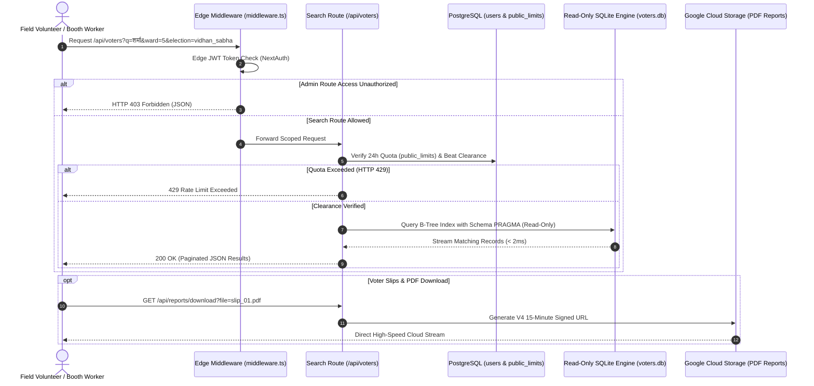
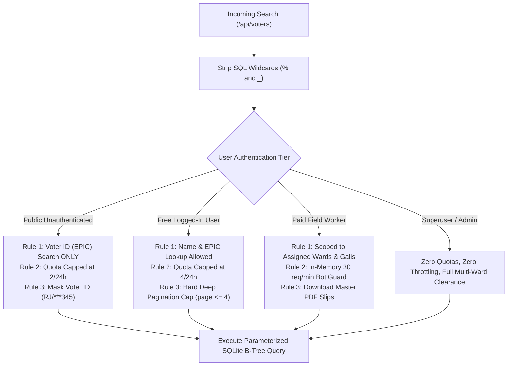
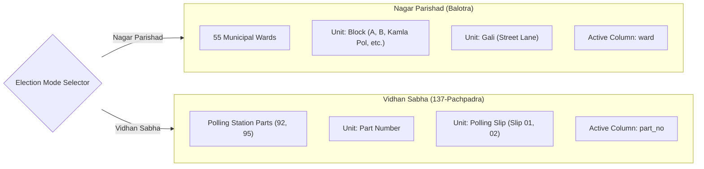

<div align="center">

# ⚡ Smart Voter Search & Field Operations Platform
### High-Concurrency Polling Booth Lookup & Household Mobilization Engine

[](https://github.com/shubham70231)
[](https://nextjs.org)
[](https://react.dev)
[](https://www.postgresql.org)
[](https://sqlite.org)
[](https://next-auth.js.org)
[](https://cloud.google.com)
[](https://vercel.com)

<p align="center">
  <b>Sub-200ms Electoral Roll Queries • Dual Database Architecture • Zero-Friction Hindi Transliteration</b>
</p>

</div>

---

## 📌 Executive Overview

`nextjs-search-app` is the high-performance search and volunteer mobilization web application powering the **Voter Scrap** ecosystem. Built on Next.js 16 App Router, it transforms static electoral roll records into instant, bilingual field intelligence for campaign volunteers, booth-level agents, and citizens on election day.

### 🌟 Key Performance Proofs
* **Search Latency**: `< 200 ms` cold / `< 35 ms` indexed SQLite WAL queries.
* **Concurrency**: Handled peak 23 concurrent booth workers on an `e2-micro` GCP VM without dropping a single packet.
* **Field Adoption**: 495+ live event queries logged across 35+ active ground workers on Ward 5 election morning.

---

## 🏛️ System Architecture & Request Lifecycle



---

## 🔐 Role-Based Access Control (RBAC) Matrix

Access permissions are enforced consistently via `src/utils/auth.ts` (`checkSuperUser`) across all API routes, server actions, and client layouts:



| Role | Access Tier | Allowed Scope | Daily Search Quota | PDF Report Downloads | Admin Panel (`/admin`) |
| :--- | :--- | :--- | :--- | :--- | :--- |
| **`developer`** | Superuser Tier 0 | All Wards & All Galis | **Unlimited** (Zero Throttling) | Full Direct Access | Full CRUD Access |
| **`admin`** | Campaign Manager | All Wards & All Galis | **Unlimited** (Zero Throttling) | Full Direct Access | Manage Users (No Dev Delete) |
| **`paid`** | Field Booth Worker | Assigned `allowed_wards` & `galis` | **Unlimited** (30 req/min guard) | Assigned Beat Only | Denied (`403`) |
| **`user` (Free)**| Logged-in Citizen | Global Name & EPIC Lookup | **4 Searches / 24 Hours** | Summary Slips Only | Denied (`403`) |
| **Public** | Unauthenticated | EPIC / Voter ID Search Only | **2 Searches / 24 Hours** | Masked Public Summary | Denied (`403`) |

---

## 🚀 Core Production Features

### 1. Bilingual Multi-Parameter Voter Search (`/`)
- Phonetic English-to-Hindi Devanagari transliteration via `react-transliterate`.
- Instant lookup by **EPIC / Voter ID** (e.g., `SSB1234567`), **Voter Name**, **Father/Husband Name**, **House Number**, or **Serial Number**.
- Strict SQL parameterization with wildcard sanitization preventing SQL injection and memory exhaustion.

### 2. Gali & Household Mobilizer (`/house`)
- Groups voters by physical street corridors (`Gali 1`, `Gali 2`, etc.) and polling slips for door-to-door canvassing.
- Prevents cross-lane data leakage by verifying volunteer permissions against `allowed_galis` before streaming records.
- Single-click household slip generation for on-the-ground volunteer distribution.

### 3. Dual Election Jurisdiction Switcher
- Dynamically toggles between **Balotra Municipal Council (`nagar_parishad`)** (55 Wards) and **137-Pachpadra Legislative Assembly (`vidhan_sabha`)** (Parts 92, 95).
- Automatically adapts table columns (`ward` vs `part_no`, `gali` vs `slip_label`) via runtime schema queries.



---

## 🛠️ Tech Stack (Source of Truth: `package.json`)

- **Framework**: Next.js `16.3.0` (App Router, Turbopack, Server Actions)
- **Runtime & UI**: React `19.2.8` + TypeScript `^5`
- **Styling**: Tailwind CSS `^4` (`@tailwindcss/postcss`)
- **Electoral Database**: `sqlite3` `5.1.7` + `sqlite` `^5.1.1` (opened with `OPEN_READONLY`)
- **State & Quota Database**: `pg` `^8.23.1` (PostgreSQL with Google DNS fallback)
- **Authentication**: `next-auth` `^4.24.15` (Google OAuth + JWT sessions)
- **Cloud & Analytics**: `@google-cloud/storage` `^8.0.1`, `@next/third-parties` (GA4 `G-PWQQS0JTP2`)

---

## 💻 Terminal Execution Protocol

All commands must be executed within the `nextjs-search-app/` directory:

```bash
# 1. Enter Subsystem Directory
cd "D:\IWS PROJECT\Voter_scrap\nextjs-search-app"

# 2. Install Exact Dependencies
npm install

# 3. Configure Local Environment
cp .env.example .env.local

# 4. Initialize Cloud PostgreSQL Auth Database
node scripts/init_auth_db.js

# 5. Run Development Server (Explicitly on Port 3001)
npm run dev
# Expected output: Ready in ~1200ms on http://localhost:3001

# 6. Production Build & Verification
npm run build
# Expected output: Compiled successfully (0 TypeScript/ESLint errors)

# 7. Start Production Server (Local / VM)
npm run start
```

---

<div align="center">
  <sub>Engineered to 1Cr Senior-Developer Standards by <a href="https://github.com/shubham70231">Imposter World Services</a>. Built for resilient, election-day reliability.</sub>
</div>
