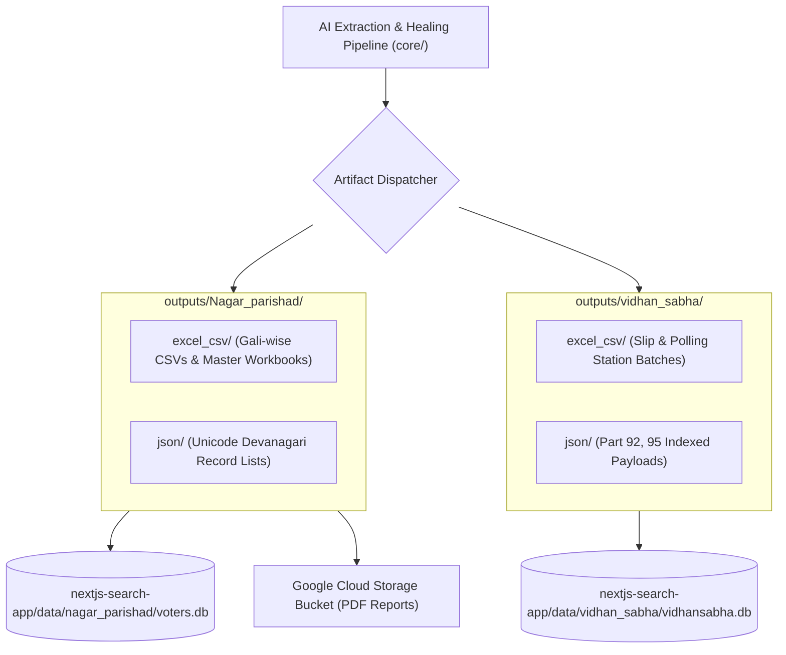

<div align="center">

# 📊 Processed Data & Exports (`outputs/`)

**Structured Outputs, Street-Wise Batches, JSON Payloads & Analytics Snapshots**

</div>

---

## 📖 Artifact Pipeline Architecture

The **`outputs/`** directory is the centralized destination where the extraction engine and conversion scripts deposit processed datasets:



---

## 📂 Directory Layout

```
outputs/
├── Nagar_parishad/            # Processed datasets for Municipal Wards
│   ├── excel_csv/             # Street-wise CSV sheets & multi-tab workbooks
│   └── json/                  # Structured JSON outputs with Devanagari Unicode
│
└── vidhan_sabha/              # Processed datasets for Legislative Assembly
    ├── excel_csv/             # Polling station slips and household batch sheets
    └── json/                  # Slip-indexed voter records
```

---

## 📑 Output Formats & Schemas

### 1. Street & Household CSVs (`outputs/.../excel_csv/`)
Designed for printing voter slips, door-to-door ground canvassing, and offline Excel tracking:
* **`Ward_5_All_Blocks_Combined.xlsx`**: Master workbook combining all sectors (Block A, Block B, Kamla Pol, Narayan Ji Ki Wadi, Sundar Complex).
* **Column Fields**: `serial_number`, `voter_id`, `name_hi`, `relative_name_hi`, `relation`, `house_number`, `age`, `gender`, `block`, `gali`.

### 2. Normalized JSON Payloads (`outputs/.../json/`)
Directly consumable by modern frontend frameworks and search indexing services:
```json
[
  {
    "serial_number": "1",
    "voter_id": "SSB1340801",
    "name_hi": "रोहित शर्मा",
    "relative_name_hi": "सुरेश शर्मा",
    "relative_type": "father",
    "house_number": "12-A",
    "age": 28,
    "gender": "male",
    "page_number": 3,
    "is_deleted_or_shifted": false
  }
]
```

---

## 🔄 Downstream Consumption

Outputs generated in this folder are selectively deployed into the active application directories:
1. **[`nextjs-search-app/data/`](file:///d:/IWS%20PROJECT/Voter_scrap/nextjs-search-app/data/)**: Primary production SQLite databases (`voters.db`, `houses.db`, `vidhansabha.db`, `vidhansabha_house.db`) queried by the voter search and household filtering engines.
2. **[`voter-portal-frontend/src/data/`](file:///d:/IWS%20PROJECT/Voter_scrap/voter-portal-frontend/src/data/)**: Public candidate profiles, symbol registries, and demographic summary JSONs.
3. **Google Cloud Storage (`ocr-voter-lists-output`)**: Cloud bucket providing backup datasets for serverless failovers.

---

<div align="center">
  <sub>Maintained to 1Cr Senior-Engineer Standards by <a href="https://github.com/shubham70231">IWS Engineering</a>.</sub>
</div>
