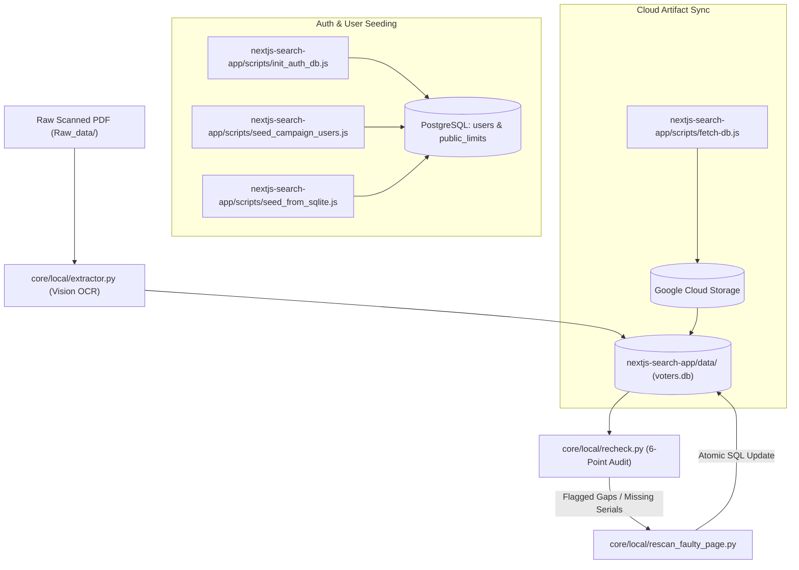

# 🛠️ Voter Scrap — Automation & Operations Scripts Guide

> **Organization**: Imposter World Services (IWS)  
> **Subsystem**: Scripts & DevOps Automation  
> **Target**: Local Environment, VM Daemons, Cloud Run Workers

---

## 1. Automation Pipeline Architecture

The scripts directory orchestrates the complete lifecycle from raw PDF ingestion down to database synchronization and surgical healing:



---

## 2. Primary Workflows

### A. Full PDF Electoral Roll Extraction
Extracts an electoral roll PDF directly into the SQLite database:
```bash
python core/local/extractor.py "Raw_data/Nagar_parishad/Ward No-005-Part No-001.pdf" --ward 5
```
* **Engine:** Powered by `gemini-2.5-flash` with Devanagari Hindi matra fidelity instructions.
* **Destination:** Automatically saved to `nextjs-search-app/data/nagar_parishad/voters.db`.

### B. Quality Audit & Recheck
Checks database accuracy and detects any corruption, Hindi spelling degradation, or missing serials:
```bash
python core/local/recheck.py --ward 5
```
* **Output:** Audit report with accuracy percentage score.
* **Auto-generated Healer:** If suspect pages are found, it generates `core/local/rescan_faulty_page.py`.

### C. Surgical Page Healing
Rescans only the flagged pages from the recheck audit:
```bash
python core/local/rescan_faulty_page.py --pdf "Raw_data/Ward-005.pdf" --pages "3,5" --ward 5
```

---

## 3. Operations & Helper Scripts Reference

| Script | Purpose | Execution Folder | Output Location |
| :--- | :--- | :--- | :--- |
| `scripts/fetch-db.js` | Downloads latest SQLite databases from GCS bucket | `nextjs-search-app/` | `nextjs-search-app/data/` |
| `scripts/init_auth_db.js` | Creates users and public_limits tables in cloud PostgreSQL | `nextjs-search-app/` | Cloud PostgreSQL |
| `scripts/seed_campaign_users.js` | Creates paid field workers and assigns ward/gali beats | `nextjs-search-app/` | Cloud PostgreSQL |
| `scripts/seed_from_sqlite.js` | Migrates legacy SQLite auth users to PostgreSQL | `nextjs-search-app/` | Cloud PostgreSQL |
| `scripts/run_all_updates.ps1` | Batch runner updating the last N pages (additions/deletions) | `Voter_scrap/` | `nextjs-search-app/data/` |
| `scripts/update_last_n_pages.py` | Surgical updater for addition/deletion pages at the end of a PDF | `Voter_scrap/` | `nextjs-search-app/data/` |
| `scripts/extract_candidates.py` | Extracts candidate profiles and symbols from PDF | `Voter_scrap/` | `outputs/json/candidates.json` |

---

## 4. Ward 5 Block & Gali Extraction (`scripts/extraction/`)

These scripts organize Ward 5 voters into specific blocks, galis, and batches, generating CSVs, JSONs, and a combined Excel workbook:

* `scripts/extraction/extract_block_a.py` $\rightarrow$ `outputs/excel_csv/Block_A_Data_v3.csv`
* `scripts/extraction/extract_block_b.py` $\rightarrow$ `outputs/excel_csv/Block_B_Data.csv`
* `scripts/extraction/extract_darzi_wali_gali.py` $\rightarrow$ `outputs/excel_csv/Darzi_Wali_Gali_Data.csv`
* `scripts/extraction/extract_narayan_ji.py` $\rightarrow$ `outputs/excel_csv/Narayan_Ji_Ki_Wadi_Data.csv`
* `scripts/extraction/extract_near_flat.py` $\rightarrow$ `outputs/excel_csv/Near_Flat_Data.csv`
* `scripts/extraction/extract_near_ramdhan.py` $\rightarrow$ `outputs/excel_csv/Near_Ramdhan_Data.csv`
* `scripts/extraction/extract_other.py` $\rightarrow$ `outputs/excel_csv/Other_Data.csv`
* `scripts/extraction/extract_sundar_complex.py` $\rightarrow$ `outputs/excel_csv/Sundar_Complex_Data.csv`
* `scripts/extraction/combine_to_excel.py` $\rightarrow$ `outputs/excel_csv/Ward_5_All_Blocks_Combined.xlsx`

---

<div align="center">
  <sub>Maintained to 1Cr Senior-Engineer Standards by <a href="https://github.com/shubham70231">IWS Engineering</a>.</sub>
</div>
