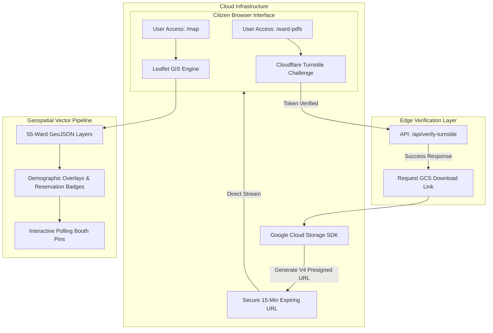

<div align="center">

# 🏛️ Civic Voter Portal & Geospatial Engine
### Bilingual Citizen Directory, 55-Ward GIS Mapping & Electoral Roll Distribution

[](https://github.com/shubham70231)
[](https://nextjs.org)
[](https://react.dev)
[](https://tailwindcss.com)
[](https://leafletjs.com)
[](https://cloudflare.com)
[](https://cloud.google.com/storage)

<p align="center">
  <b>55-Ward GeoJSON Polygon Render • Cloudflare Bot Shield • Zero-Friction Bilingual UI (EN / HI)</b>
</p>

</div>

---

## 📌 Executive Overview

`voter-portal-frontend` is the public-facing civic technology portal for municipal and legislative elections. It delivers an accessible, high-performance web app allowing citizens to locate their polling booths on an interactive GIS map, review candidate manifests with Devanagari transliteration, and download official electoral roll PDFs securely protected against automated scraping.

---

## 🏛️ Geospatial & Secure Download Architecture



---

## 🚀 Core Civic Features

### 1. Interactive 55-Ward Geospatial Map (`/map` & `/booth`)
* High-density polygon rendering powered by **Leaflet** and **React-Leaflet**.
* Visual demographic breakdowns, population quotas, and reserved ward classifications.
* Direct integration with GPS geolocation for polling booth proximity routing.

### 2. Candidate Registry & Symbol Directory (`/candidates`)
* Comprehensive candidate rosters categorized by municipal ward.
* Integrated phonetic English-to-Hindi search with real-time party symbol rendering.

### 3. Bot-Shielded Electoral Roll Downloads (`/ward-pdfs`)
* Prevents automated mass-harvesting using **Cloudflare Turnstile** invisible CAPTCHA.
* Verified requests receive short-lived, V4-signed **Google Cloud Storage** download URLs, offloading bandwidth from edge compute.

### 4. Turnout Analytics & Polling Verification (`/live-turnout`)
* Certified voting turnout statistics and demographic participation ratios for completed ward elections.
* Integrated keypad verification for instant offline voter slip checks.

---

## 🛠️ Tech Stack (Source of Truth: `package.json`)

- **Framework**: Next.js `16.3.3` (App Router, Server Components)
- **UI & Runtime**: React `19.2.8` + TypeScript `^5`
- **Styling**: Tailwind CSS `^4` (`@tailwindcss/postcss`) + Framer Motion `^13`
- **Geospatial Engine**: `leaflet` `^1.9.4` + `react-leaflet` `^5.0.0`
- **Security & Bot Protection**: `@marsidev/react-turnstile` `^1.6.1`
- **Cloud Delivery**: `@google-cloud/storage` `^8.0.1`
- **Analytics & Tracking**: `@next/third-parties` (GA4) + `@vercel/analytics`

---

## 💻 Terminal Execution Protocol

All commands must be executed within the `voter-portal-frontend/` directory:

```bash
# 1. Enter Directory
cd "D:\IWS PROJECT\Voter_scrap\voter-portal-frontend"

# 2. Install Exact Dependencies
npm install

# 3. Configure Local Secrets
# Create .env.local with Turnstile & GCS credentials:
# NEXT_PUBLIC_TURNSTILE_SITE_KEY="your-site-key"
# TURNSTILE_SECRET_KEY="your-secret-key"
# GCP_PROJECT_ID="your-project-id"
# GCS_BUCKET_NAME="ocr-voter-lists-archive"

# 4. Run Development Server (Explicitly on Port 3000)
npm run dev
# Expected output: Ready in ~1.5s on http://localhost:3000

# 5. Production Build
npm run build
# Expected output: Compiled successfully (0 TypeScript/ESLint errors)

# 6. Start Production Daemon
npm run start
```

---

<div align="center">
  <sub>Designed & Maintained to 1Cr Standards by <a href="https://github.com/shubham70231">Imposter World Services</a>. Open, resilient civic technology.</sub>
</div>
